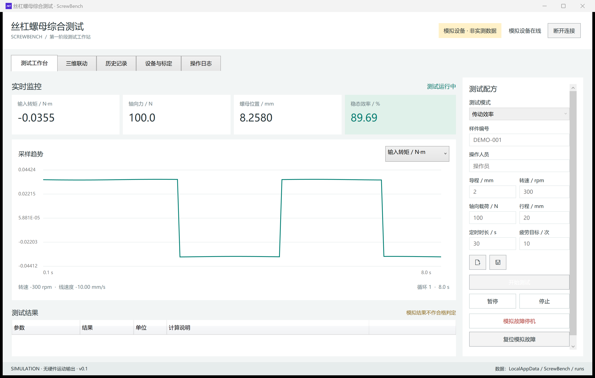
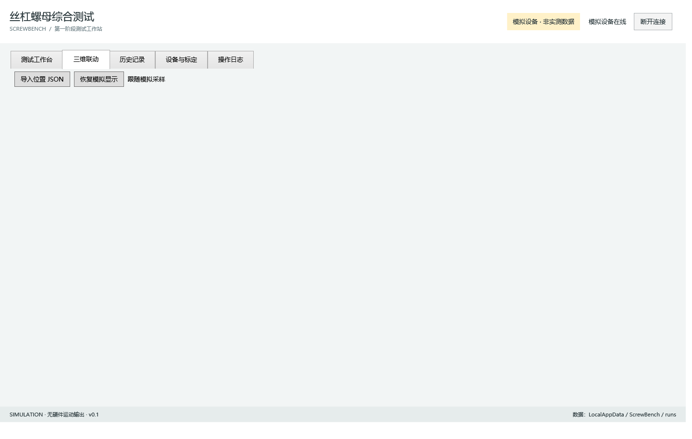
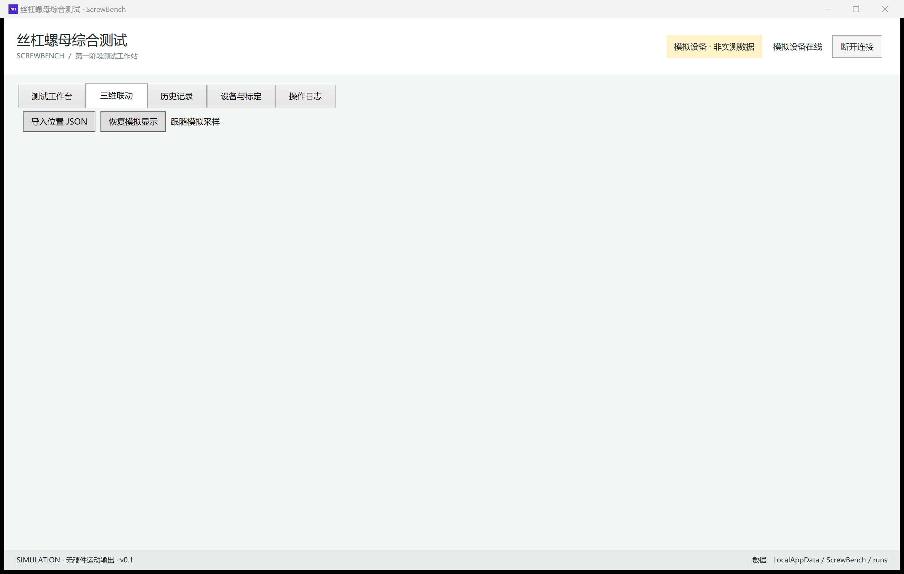
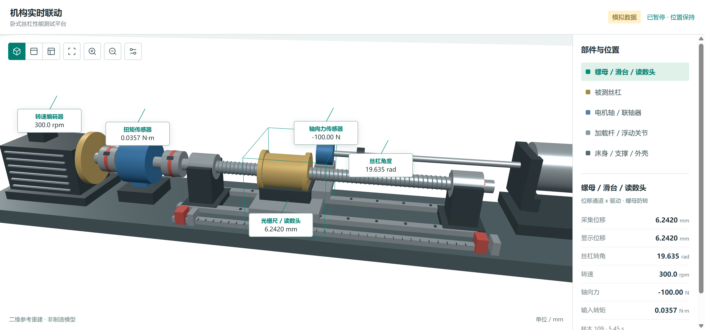
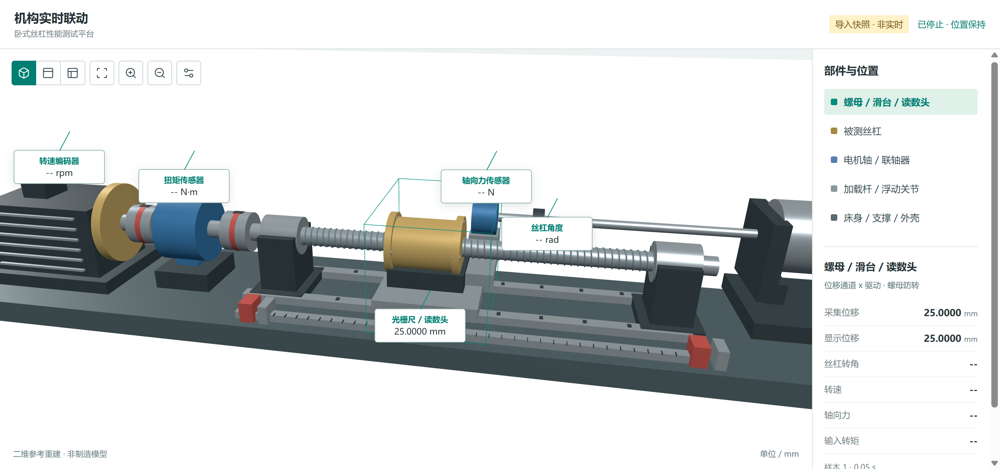
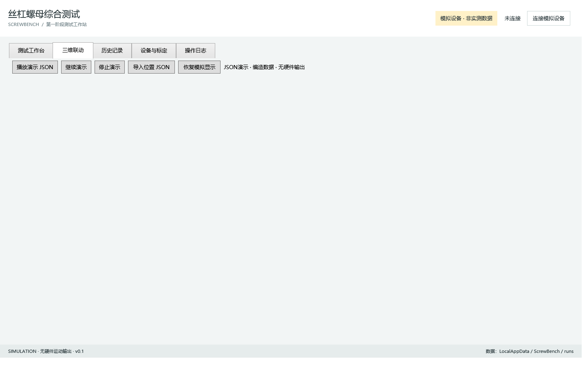
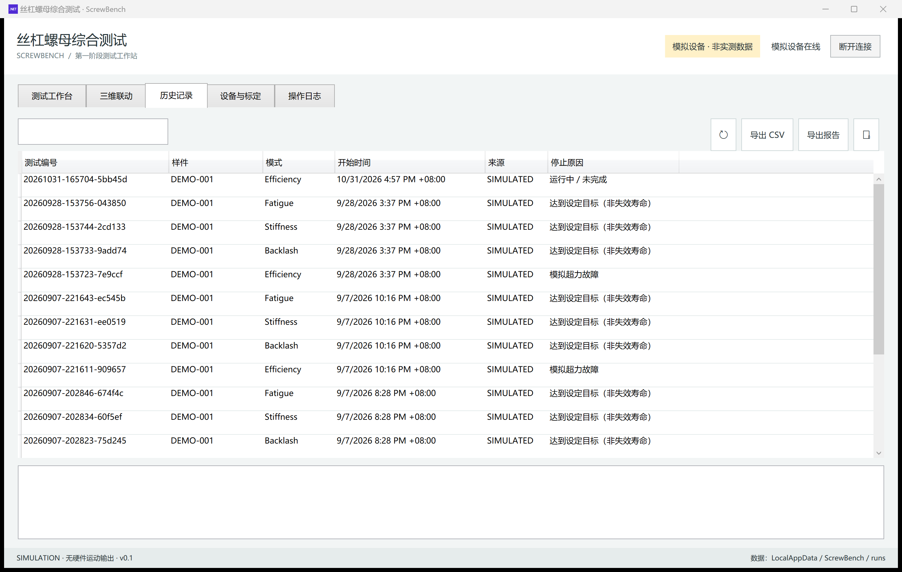
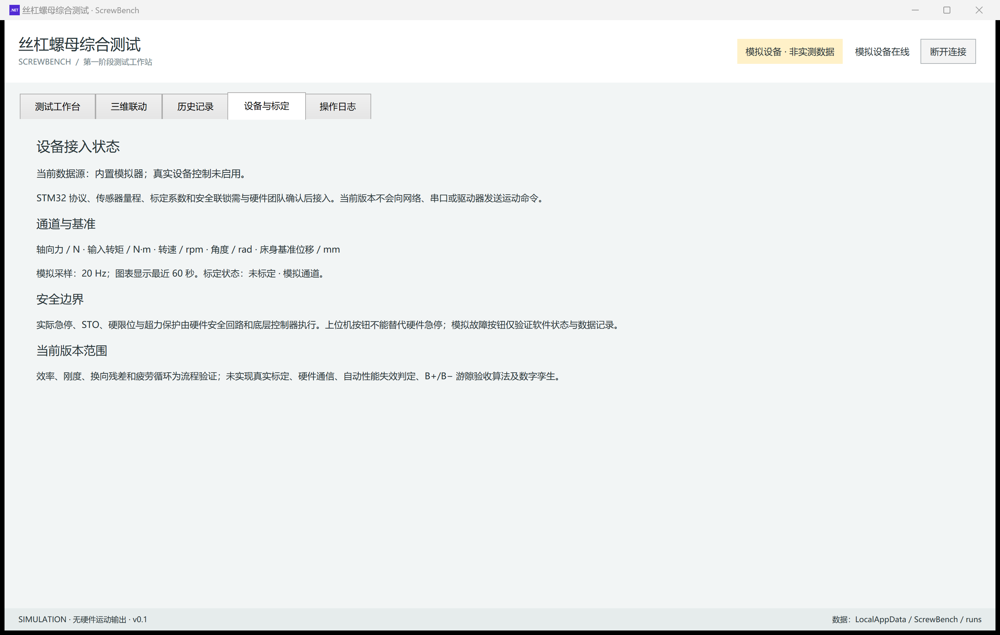
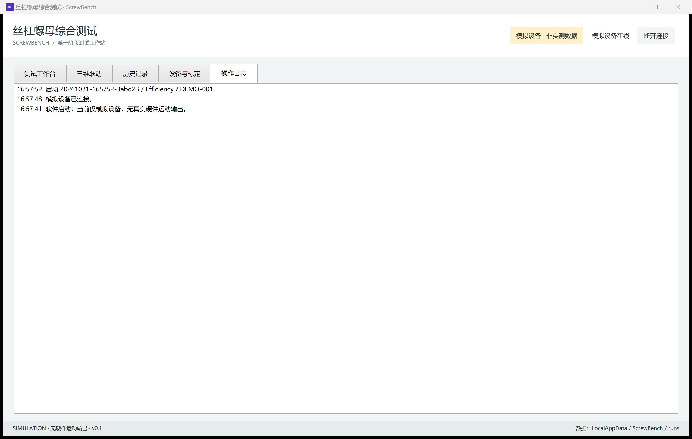

# 丝杠螺母效率测试上位机

**© 著名原创**

ScrewBench：滚珠丝杠 / 螺母综合效率测试上位机（Windows WPF + WebView2 + Three.js）。当前为模拟运行版，含卧式平台三维联动。

更新日期：2026-10-31。当前版本：0.1。

## 界面预览

### 测试工作台



模拟运行中：



### 三维联动



模拟运行：



导入位置 JSON：



JSON 演示：



### 历史记录



### 设备与标定



### 操作日志



> 说明：当前已验证产物 `artifacts/position-input-20260928` 以三维位置输入与模拟运行为主；「数据包调试」独立窗口见源码，该窗口未纳入当前公开构建包。截图来自本机模拟运行，界面数据均标记为模拟，不得用于设备验收。

## 三维联动

新增 JSON 动态演示：双击「播放演示.cmd」直接播放，或在三维页点击「播放演示 JSON」。读取 `examples/motion-demo.json` 的编造数据，10–80 mm 往返，8 秒循环；五个数据框动态显示，长引线连接对应部件。支持暂停、继续和停止。当前启动入口优先采用 `artifacts/json-demo-20260928` / `artifacts/position-input-20260928`，无硬件控制输出。详见 `docs/JSON动画演示.md`。

2026-09-28 新增：三维页可「导入位置 JSON」并「恢复模拟显示」。支持仅输入位移，读数头、滑台和螺母移动，光栅尺身固定；缺失的转角、力等通道显示为未提供。示例位于 `examples`，接口说明见 `docs/三维位置输入接口.md`。当前为显示接口及快照导入；真实 TCP 接收可按同一接口接入。

在测试工作台连接模拟设备并开始测试，再切换到「三维联动」页。三维与工作台使用同一份采样数据，切换页面不会中断测试。可拖动旋转、滚轮缩放，切换轴测/正视/俯视，点击部件查看通道值。要暂停或停止测试，请切回测试工作台操作。

模型依据根目录参考图的卧式布局重建，不是之前的立式 STEP 总装。模型是工程示意，外形尺寸未经过实机测量，不可作为制造依据。

螺母、滑台及光栅读数头由位移驱动；丝杠由转角驱动；传动轴按 1:1 直联假设联动；加载连接杆按滑台位置作几何伸缩，不冒充电缸独立位置反馈。详见 `docs/三维联动说明.md`。

三维采用离线 Three.js + WebView2，不依赖在线 CDN。需要 Microsoft Edge WebView2 Runtime。三维资源已构建；修改前端源码后，在 `tools/scene` 运行 `npm ci`、`npm run build`，再重新构建 WPF 项目。

## 启动

双击本目录的 `启动上位机.cmd`。连接模拟设备后，填写测试配方并开始测试。
当前启动入口优先使用 `artifacts/position-input-20260928` 中已验证的位置输入版。
暂停、继续、停止和故障复位均可在界面操作。测试停止或完成后，在历史记录中选择记录，导出 CSV 或 HTML 报告。

当前程序不会向真实设备发送任何命令。所有数据与报告均标记为模拟数据，不得用于设备验收。

## 已实现

| 模块 | 当前能力 |
| --- | --- |
| 测试工作台 | 四种模式、配方范围检查、开始、暂停、继续、停止 |
| 实时监控 | 转矩、轴向力、位移、转速、线速度、效率、循环计数；单通道切换曲线 |
| 模拟流程 | 传动效率、游隙换向残差、轴向等效刚度、往复疲劳循环 |
| 配方 | JSON 导入及保存；运行中锁定编辑 |
| 数据记录 | 原始 CSV、结果 JSON、操作日志；按编号及样件搜索历史 |
| 报告 | 单次记录的 HTML 报告，支持浏览器查看及打印 |
| 状态管理 | 未连接、就绪、运行、暂停、完成、停止、故障锁存与人工复位 |
| 三维联动 | WebView2 + Three.js 卧式台架示意、模拟联动、JSON 导入与演示 |

源码中另有「数据包调试」独立窗口（TCP 监听/连接、十六进制转储、按外置 JSON 布局解析）；该窗口未纳入当前公开构建包，可在后续改进中编入正式产物。

## 后续改进方向

- 接入 STM32 实际通信、驱动器控制、真实数据采集与标定。
- 完善正式游隙验收算法、台架柔度补偿、测量不确定度与合格判定。
- 扩展硬件报警接入、断线恢复、长周期疲劳连续运行验证。
- 增强历史曲线回放、用户权限、数据库、自动备份及安装包。
- 推进真实设备三维通道核定、机理仿真、健康度与剩余寿命预测。

## 文件及数据

- `src/Core`：配方、模拟采样、指标计算、记录存储。
- `src/Desktop`：Windows 界面、流程调度、曲线与报告。
- `tests/Core.Tests`：无需第三方测试包的计算回归自检。
- `docs/`：设计说明、三维说明、截图等。
- 数据目录：`%LOCALAPPDATA%\ScrewBench\runs`。
- 界面自检结果与截图：`%LOCALAPPDATA%\ScrewBench\qa`。

## 构建及验证

本机已安装项目专用 .NET 8 SDK，路径为 `%LOCALAPPDATA%\ScrewBench\dotnet`。
在本项目目录运行：

```powershell
& "$env:LOCALAPPDATA\ScrewBench\dotnet\dotnet.exe" build src/Desktop/Desktop.csproj -c Release
& "$env:LOCALAPPDATA\ScrewBench\dotnet\dotnet.exe" run --project tests/Core.Tests/Core.Tests.csproj -c Release
$p = Start-Process src/Desktop/bin/Release/net8.0-windows/ScrewBench.exe -ArgumentList '--smoke' -WindowStyle Hidden -PassThru
$p.WaitForExit()
Get-Content "$env:LOCALAPPDATA\ScrewBench\qa\smoke.txt" -Encoding UTF8
```

界面自检约需 45 秒，会运行四种模拟模式，生成带 SIMULATED 标记的测试记录，完成后自动关闭。

---

© 著名原创