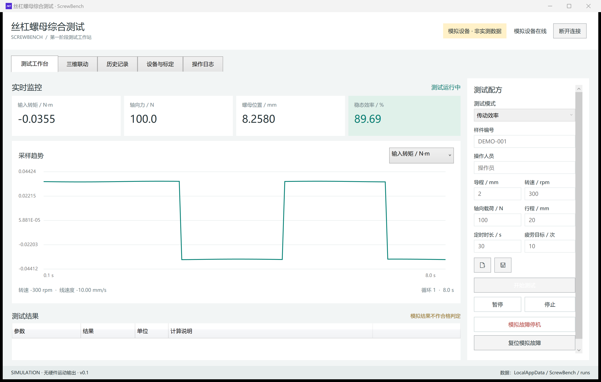
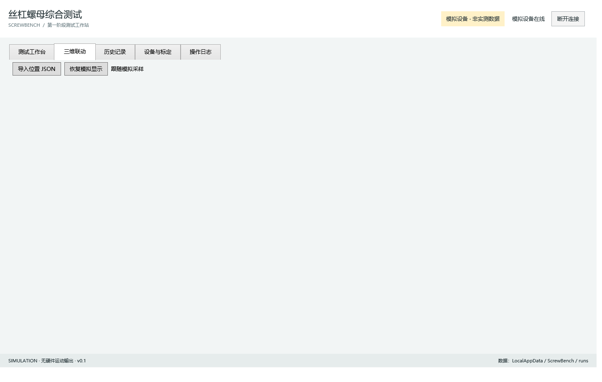
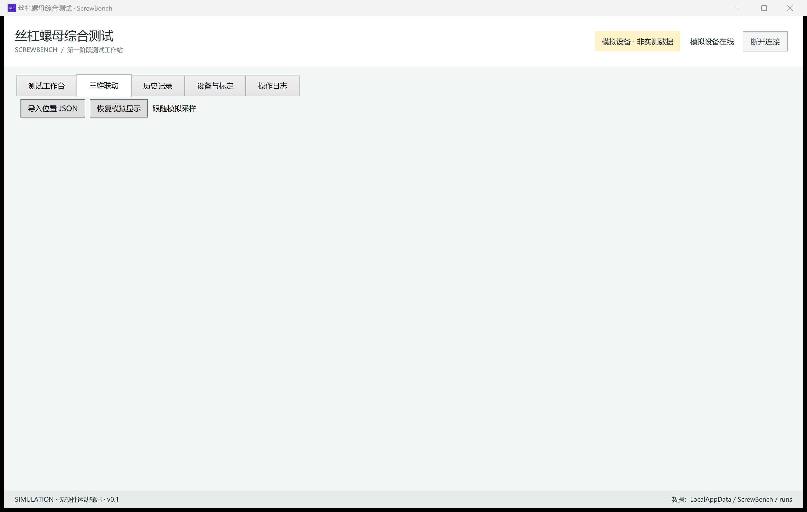
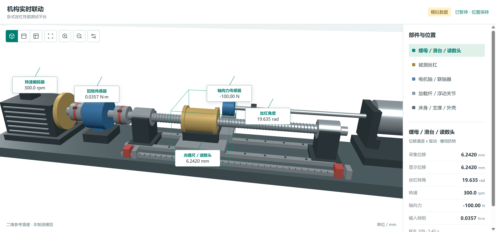
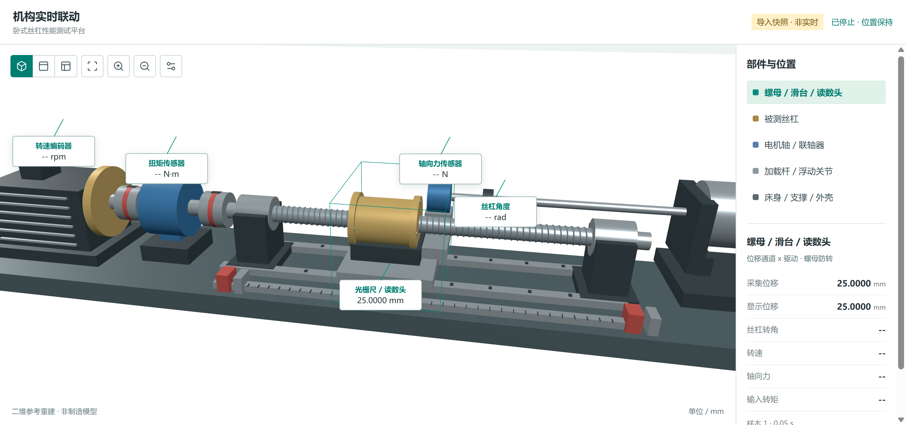
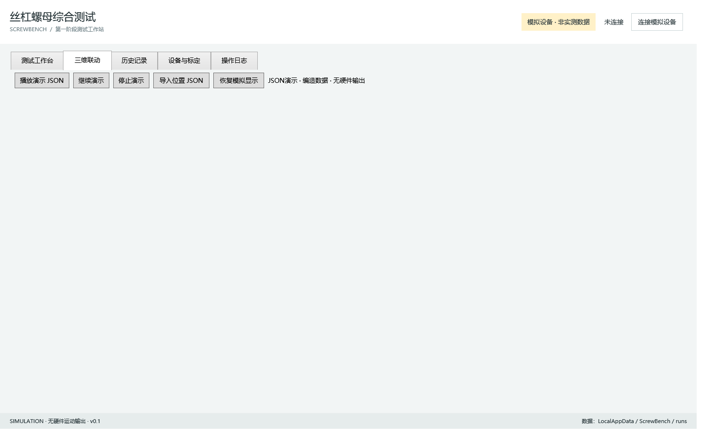
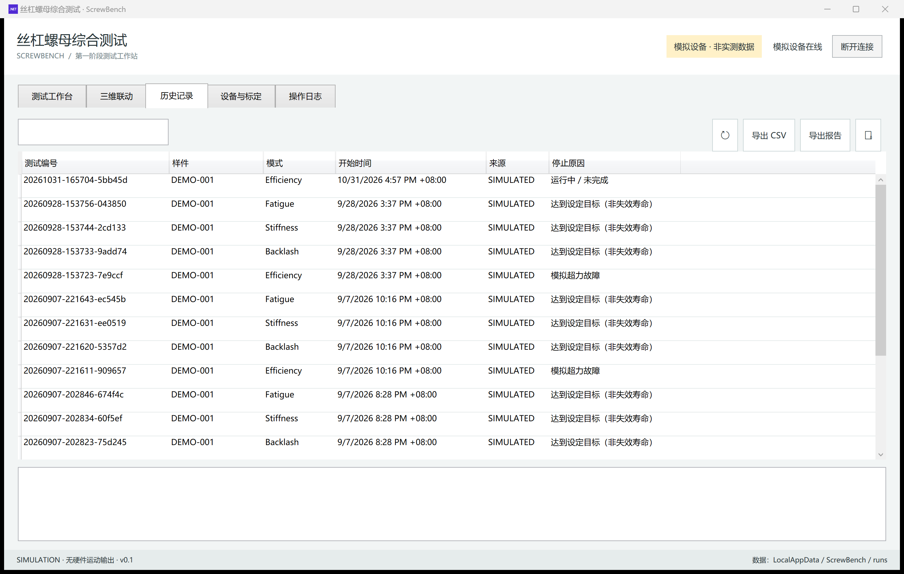
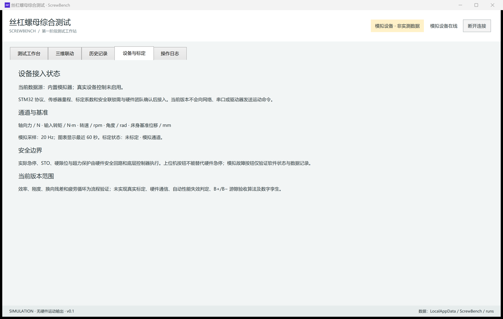
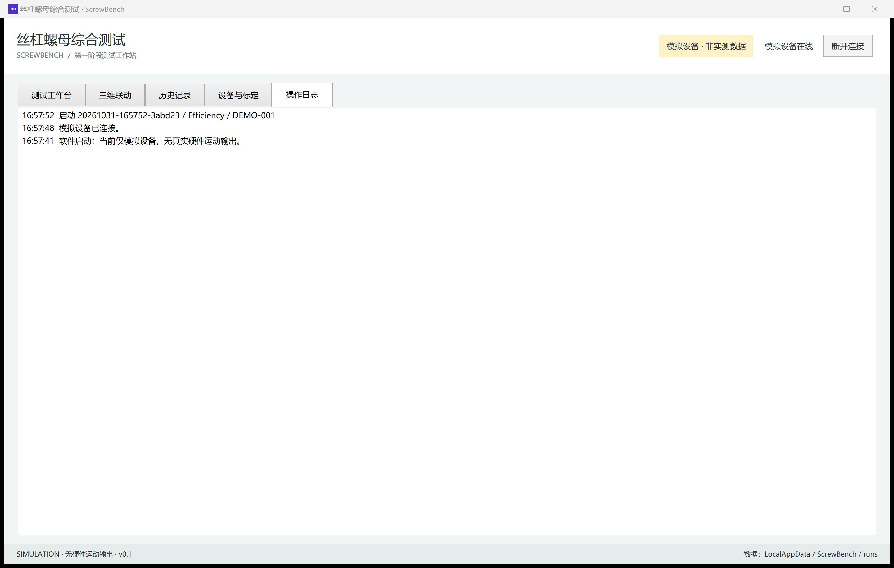

# Ball-Screw / Nut Efficiency Test HMI

[中文](README.md) | English

**© 著名原创**

ScrewBench: a ball-screw / nut efficiency test HMI (Windows WPF + WebView2 + Three.js). Current release is a simulation build with horizontal-bench 3D linkage.

Updated: 2026-10-31. Version: 0.1.

## UI Preview

### Test Bench



Simulation running:



### 3D Linkage



Simulation:



Import position JSON:



JSON demo:



### History



### Devices & Calibration



### Operation Log



> Note: the currently verified artifact `artifacts/position-input-20260928` focuses on 3D position input and simulation. The separate “packet debug” window exists in source but is not included in the current public build. Screenshots are from local simulation; all UI data is marked simulated and must not be used for equipment acceptance.

## 3D Linkage

New JSON motion demo: double-click `播放演示.cmd` to play, or click “Play demo JSON” on the 3D page. It reads fabricated data from `examples/motion-demo.json`, 10–80 mm round trips, 8-second loop; five value boxes update dynamically with long leader lines to the matching parts. Pause, resume, and stop are supported. Startup currently prefers `artifacts/json-demo-20260928` / `artifacts/position-input-20260928`, with no hardware control output. See `docs/JSON动画演示.md`.

Added 2026-09-28: the 3D page can “Import position JSON” and “Restore simulation display”. Displacement-only input is supported—read head, carriage, and nut move while the scale body stays fixed; missing channels such as angle or force show as not provided. Examples live under `examples`; the interface is documented in `docs/三维位置输入接口.md`. This is a display / snapshot-import API; real TCP reception can plug into the same interface later.

Connect a simulated device on the test bench, start a test, then switch to the “3D Linkage” page. 3D and the bench share the same sample stream, so switching pages does not interrupt the test. Drag to rotate, scroll to zoom, switch isometric / front / top views, and click parts to inspect channel values. To pause or stop a test, switch back to the test bench.

The model rebuilds the horizontal layout from the root reference images; it is not the earlier vertical STEP assembly. It is an engineering schematic—dimensions were not measured from a real machine and must not be used for manufacturing.

Nut, carriage, and scale read head are driven by displacement; the screw by angle; the drive shaft assumes 1:1 direct coupling; the load link telescopes geometrically with carriage position and does not pretend to be an independent cylinder position feedback. Details: `docs/三维联动说明.md`.

3D uses offline Three.js + WebView2 (no online CDN). Microsoft Edge WebView2 Runtime is required. 3D assets are already built; after changing frontend sources, run `npm ci` and `npm run build` under `tools/scene`, then rebuild the WPF project.

## Launch

Double-click `启动上位机.cmd` in this directory. After connecting a simulated device, fill in the test recipe and start. Startup currently prefers the verified position-input build under `artifacts/position-input-20260928`. Pause, resume, stop, and fault reset are available in the UI. After a test stops or finishes, select a record in History to export CSV or an HTML report.

The program never sends commands to real hardware. All data and reports are marked as simulated and must not be used for equipment acceptance.

## Implemented

| Module | Current capability |
| --- | --- |
| Test bench | Four modes; recipe range checks; start / pause / resume / stop |
| Live monitoring | Torque, axial force, displacement, speed, linear velocity, efficiency, cycle count; single-channel curve switch |
| Simulation flows | Transmission efficiency, backlash reversal residual, axial equivalent stiffness, reciprocating fatigue cycles |
| Recipes | JSON import and save; edit locked while running |
| Data logging | Raw CSV, result JSON, operation log; history search by ID / specimen |
| Reports | Per-record HTML report for browser view and print |
| State management | Disconnected, ready, running, paused, finished, stopped, fault latch with manual reset |
| 3D linkage | WebView2 + Three.js horizontal bench schematic, simulated linkage, JSON import and demo |

Source also contains a separate “packet debug” window (TCP listen/connect, hex dump, parse via external JSON layout). That window is not in the current public build and can be folded into official artifacts in later improvements.

## Follow-up Improvement Directions

- Connect real STM32 communication, drive control, acquisition, and calibration.
- Formalize backlash acceptance algorithms, bench compliance compensation, measurement uncertainty, and pass/fail criteria.
- Extend hardware alarms, reconnect recovery, and long-duration fatigue continuous-run validation.
- Enhance history curve replay, user permissions, database, auto-backup, and installer packaging.
- Advance real-device 3D channel verification, mechanism simulation, health scoring, and remaining-life prediction.

## Files & Data

- `src/Core`: recipes, simulated sampling, metric calculation, record storage.
- `src/Desktop`: Windows UI, workflow orchestration, curves and reports.
- `tests/Core.Tests`: calculation regression self-checks without third-party test packages.
- `docs/`: design notes, 3D notes, screenshots, etc.
- Data directory: `%LOCALAPPDATA%\ScrewBench\runs`.
- UI self-check results and screenshots: `%LOCALAPPDATA%\ScrewBench\qa`.

## Build & Verify

A project-local .NET 8 SDK is installed at `%LOCALAPPDATA%\ScrewBench\dotnet`. From this project directory:

```powershell
& "$env:LOCALAPPDATA\ScrewBench\dotnet\dotnet.exe" build src/Desktop/Desktop.csproj -c Release
& "$env:LOCALAPPDATA\ScrewBench\dotnet\dotnet.exe" run --project tests/Core.Tests/Core.Tests.csproj -c Release
$p = Start-Process src/Desktop/bin/Release/net8.0-windows/ScrewBench.exe -ArgumentList '--smoke' -WindowStyle Hidden -PassThru
$p.WaitForExit()
Get-Content "$env:LOCALAPPDATA\ScrewBench\qa\smoke.txt" -Encoding UTF8
```

UI self-check takes about 45 seconds, runs all four simulation modes, writes SIMULATED-tagged test records, then exits automatically.

---

© 著名原创
